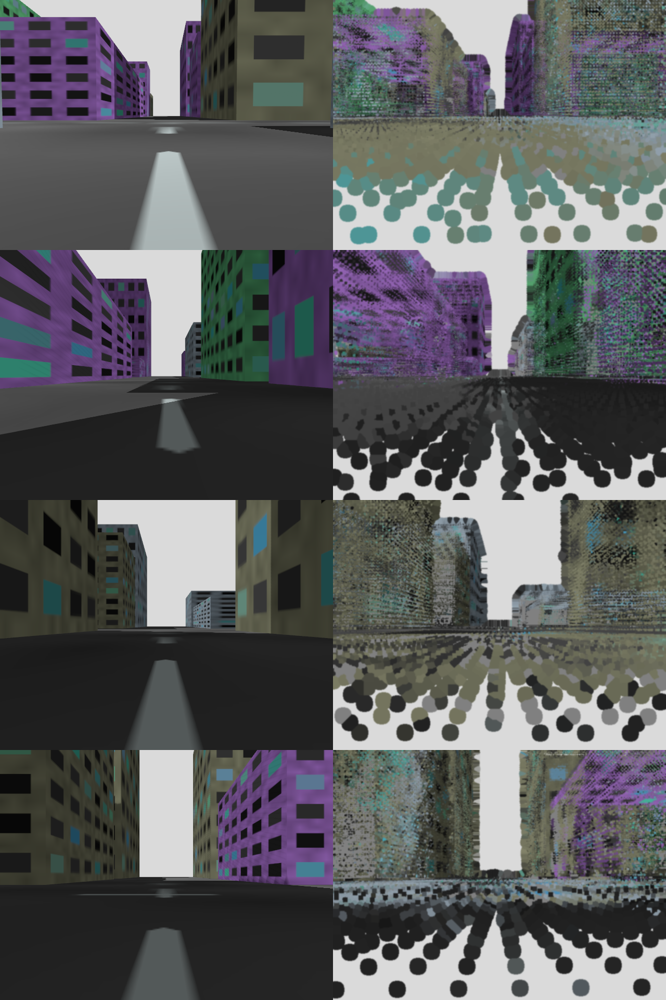
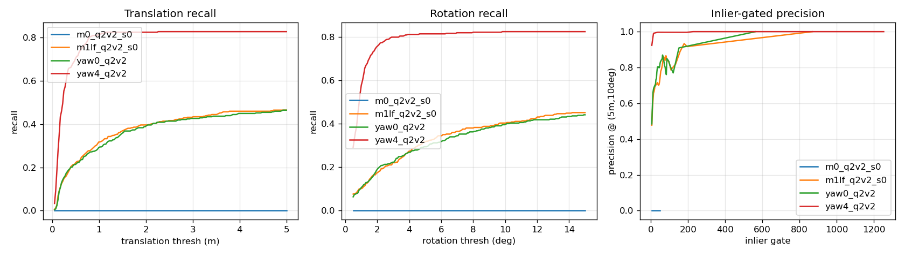

# Localizing a camera-only ground robot in a LiDAR map built by a drone: progress report and experiments

Status: continuously updated. All work is done in simulation (Gazebo Harmonic + ROS 2 Jazzy) on one RTX 4060 Ti (8 GB). The report separates what was measured and can be trusted from what is uncertain, and lists the author's own mistakes.

## 0. One-page summary

**Problem.** A drone with a LiDAR and a camera surveys a city and builds a map. A ground robot with **only a camera** must estimate its own 6-DoF pose in that map. The difficulty: the map is geometry (3D points), the robot sees images, and the viewpoints differ a lot (drone at 45 m looking down, robot at 0.45 m looking along the street).

**Method.** Render the coloured LiDAR map (coloured by the drone camera) from thousands of ground-level viewpoints, keep for every rendered pixel the 3D map point it came from (provenance), match the real robot image against the rendered views with a learned matcher, and solve PnP + RANSAC to get a pose at true scale. A global descriptor (MegaLoc) shortlists the views.

**Main results that can be trusted**
1. A map made of drone *images* does not work for a ground robot (0 % of 819 queries), because **64.8 % of street-level wall points were never seen by any drone image**. The rendered LiDAR map works.
2. In the test room the method is correct for 86.1 % of queries at the strict threshold (0.25 m, 2 deg) versus 72.4 % for the image map; with the camera facing the reverse direction the image map gets 0 % and this method 53-56 %.
3. In the city, with a position prior from odometry (+-5 m), the original LoFTR-based version was correct (<= 5 m, 10 deg) for **72-80 %**, and with multi-frame agreement the grossly wrong accepted rate was **about 2.2 %** at about 69 % accepted (a route not used for tuning).

**Second round (section 4.9).** Switching the matcher to DISK + LightGlue raised coarse accuracy (<= 5 m, 10 deg) to **86-97 %** and fine accuracy (<= 0.5 m, 5 deg) to **39-48 %** at about 0.4-0.9 s per frame on the development world. A particle filter with a spread gate removed all grossly wrong accepted poses on two routes. A learned confidence gate transferred across worlds (AUROC 0.96-0.99). **However**, on five randomly generated worlds with frozen settings the coarse accuracy was only 0-56 % (one world could not be evaluated because the drone's LiDAR odometry failed), closed-loop driving did not complete the route, and **a 0.5 deg colour-registration error cuts fine accuracy from 41 % to 10 %**.

**Not solved or uncertain.** Fine accuracy has a floor near 0.5 m (five attempted fixes failed), the grossly wrong rate is still above the 1 % target in the hard cases, global (no prior) localization is not usable in new worlds, there is no real data, and lighting changes, dynamic objects and weather are untested.

**Caveats that must always be stated.** Simulation only (pinhole camera, constant lighting, no vehicles or people). Several steps use ground truth (colouring the map with simulator camera poses, aligning the map to the world). It is a design study, not a deployed system, and the work **does not claim to be first** (section 8).

## 1. Environment and data

| Item | Value |
|---|---|
| Machine | Windows 10, WSL2 Ubuntu 24.04, RTX 4060 Ti 8 GB, WSL RAM capped at 11 GB |
| Software | Gazebo Harmonic (headless sensor rendering), ROS 2 Jazzy, FAST-LIO2, PyTorch 2.6, Kornia (LoFTR, DISK, LightGlue, XFeat), MegaLoc |
| Test room | 30 x 20 m with 18 randomly textured boxes; the robot has a 32-beam LiDAR, an IMU and a 640 x 480 camera (HFOV 1.2 rad, fx = 467.7) |
| Test city | 200 x 200 m, 50 buildings (4-35 m), 10 m streets, 3 m alleys, facades with 4 repeated textures |
| Drone | 64-beam LiDAR (100 m range), camera pitched down 0.7 rad, IMU; four lanes at 45 m altitude, 4 m/s (841 m) |
| Ground robot | single camera at 0.45 m, 1 m/s along street centres |
| Success thresholds fixed in advance | (0.25 m, 2 deg), (0.5 m, 5 deg), (5 m, 10 deg), Aachen style |

Main datasets: room v1 (map `s0` 287 images, queries `q1` 154 images); room v2 (unique textures: map 349, `q1v2` 380 same direction, `q2v2` 394 reversed, `q3v2` 619 rotating in place); city (drone `ud0` 479 images; robot `ug1` 819 images, `ug2` independent route 569 images).

## 2. Methods compared

- **M0 (image baseline):** SIFT + triangulation with ground-truth poses (known-pose SfM), descriptor voting for retrieval, then PnP. It is the ceiling of an image map, not a usable system.
- **M1 (this work):** coloured LiDAR map -> rendered images + provenance (pixel -> 3D point) -> matching -> PnP.
  - M1 + SIFT: failed (kept as a negative result).
  - M1 + LoFTR: works (slow because it matches every render).
  - M1 + fast LoFTR: GPU z-buffer renderer, coarse-to-fine search, **MegaLoc retrieval**, multi-yaw or file-based viewpoints, prior mode, multi-frame consensus.
  - Later (section 4.9): XFeat and DISK + LightGlue matchers, particle filter, learned gate.
- **M2-M4** (learned image-to-point-cloud, Gaussian splatting, scene-coordinate regression): not done; deprioritized by measurement (section 4.4).

## 3. Results in order

### 3.1 First test room (v1)
| Method | Pose returned | Correct (0.25 m, 2 deg) | Correct (5 m, 10 deg) | Note |
|---|---|---|---|---|
| M0 | 61.0 % | 50.0 % | 59.7 % | ceiling of an image map |
| M1 + SIFT | 0.6-2.6 % | ~0.6-2.6 % | - | rendered images lack the fine texture SIFT needs |
| M1 + LoFTR | 91.6 % | 70.8 % | 75.3 % | works, but 16 % are grossly wrong (see 3.2) |

Time per image was 9.3 s because every render is matched. These numbers are from after an audit fixed a reversed painter's-order bug in the renderer.

### 3.2 An audit found aliasing; fixed in the world
The 25 wrong poses of M1 + LoFTR (out of 154) were **not a PnP bug** but point reflections through the room centre (position error = 2x the distance to the centre, rotation off by ~180 deg), because **all four walls used the same texture** (a symmetric room). The wrong poses even had more inliers (median 204), so an inlier-count filter could not help. In the re-recorded v2 data, where every wall and box has a different texture, wrong poses fell to **1.6 %**.

### 3.3 Room v2: M0 vs M1 and viewpoint change
| Query set | Method | Pose returned | Correct (0.25 m, 2 deg) | Correct (5 m, 10 deg) |
|---|---|---|---|---|
| `q1v2` same direction (380) | M0 (3 seeds) | 85.9 % | 72.4 +- 1.5 % | 82.8 % |
| | M1 + LoFTR | 93.4 % | **86.1 %** | **91.8 %** |
| `q2v2` reversed camera (394) | M0 | 13.2 % | **0.0 %** | **0.0 %** |
| | M1, single view | 63.7 % | 13.7 % | 40.4 % |
| | M1, **4 synthetic yaws** | 83.8 % | **53.3 %** | **82.5 %** |
| `q3v2` rotating in place (619) | M0 | - | 10.8 % | 12.6 % |
| | M1, 4 yaws | - | 56.9 % | 77.2 % |

- The benefit of synthetic yaws falls with the distance from the prepared directions (at the strict threshold +39 / +17 / +9 points for 0-15 / 15-30 / 30-45 deg offset), so a finer yaw set than 90 deg should help (not tested).
- The +- is RANSAC randomness only; M1 + LoFTR gave identical results for every seed, which is not evidence of stability across worlds.

### 3.4 Speed and retrieval
- Vector retrieval: LoFTR's own internal features were not good enough for retrieval (R@50 = 77 % on the hard set); **MegaLoc** (228.6 M parameters, 915 MB) reached R@50 = 90 % at about 8.5 ms per image. End to end it lost nothing at the loose threshold compared with searching every render, was 2.8x faster (2.3 s vs 6.4 s) and lost 3 points at the strict threshold on the rotating set.
- Trade-off: K = 20 with a 6-image fine check gave 1.05 s but the strict threshold fell from 56.1 % to 46.4 % (`q2v2`). Nearly all of the 2.3 s was LoFTR (coarse 1.09 s + full 1.17 s).
- fp16 hurt accuracy when combined with the coarse search (flipped 14 vs 4 queries).

### 3.5 A decision model for "can this pose be trusted": first attempt not good enough
A "System One"-style idea (a fast model that returns a typed decision with a probability rather than free text) was adapted as a small classifier over PnP statistics that accepts or rejects a pose. Leave-one-session-out result: **the inlier count (the standard signal) reached AUROC 0.994 for the same direction but 0.506 (chance) for the reversed camera**. The learned model reached 0.75 on the reversed camera but lost on the same direction; it missed the target. The missing information was cross-frame consistency, which led to the multi-frame results in 4.7.

## 4. The city series (the main problem)

### 4.1 The drone map
FAST-LIO2 on the drone flight reached **ATE 8.3 cm** (max 24 cm) over 841 m and produced a 2.37 M-point map. Checked against the true geometry of the city (the ground plane z = 0 and the known building boxes): ground mean offset -0.007 m, walls within +-0.01 m in every direction, ground tilt 0.002 deg -> **the map matches the world to about 1 cm**.

### 4.2 The drone camera sees very little of what the ground robot sees
| Map point group | Never seen by a drone image | Seen by >= 3 images |
|---|---|---|
| Street-level walls (z < 3 m) | **64.8 %** | **19.2 %** (median = 0 images) |
| Walls 3-10 m | 54.7 % | 28.8 % |
| Walls >= 10 m | 32.3 % | 44.9 % |
| Ground / roofs | 35.4 % | 51.1 % |

M0 on ground queries scored **0 % of 819 images** (control: M0 on drone images scored 95.4 %, so the data pipeline is not broken).

### 4.3 First M1 run on the city: 9.8 %, and why
The first run was correct for only **9.8 %** at (5 m, 10 deg) on 205 queries, below the pre-set decision gate (20 %), so diagnosis came before optimization:

| Check | Result |
|---|---|
| Render at the query's own ground-truth pose (zero viewpoint gap) | matching succeeded for only 8.8 % -> **the problem is appearance, not retrieval** |
| Fill the colour of never-seen points from neighbouring points | -> 35.1 % |
| Change splat size from 0.03 m (tuned on the 0.1 m room map) to 0.12 m (city map voxel 0.25 m) | -> **70-73 %** |
| Full pipeline after the fixes (search over the whole city from scratch) | **50.2 %**, pose returned 88.8 %, median error 0.94 m |

Even at perfect poses about 27 % still failed to match, the 6 m viewpoint grid cost another 8-10 points, and retrieval (MegaLoc R@50 = 69.8 %) was the largest loss.

### 4.4 Why M3/M4 (training from drone images) were not done
74.5 % of street-level wall points were seen by at most one drone image, so methods that learn from drone images (Gaussian splatting, scene-coordinate regression) have no data for more than three quarters of what the robot sees. This is consistent with M0 = 0 %. No official 3DGS-ReLoc repository was found at the time, and R-SCoRe needs 4 x RTX 4090 for 4-8 hours of training, which does not fit an 8 GB card.

### 4.5 Position-prior mode (odometry): the most important result
The prior was simulated as the ground-truth position plus noise (+-5 m), restricting the views to a 20 m radius around it (equivalent to "tile streaming", where the robot loads only the area near it).

| (205 queries) | No prior | Prior +-5 m | Prior +-10 m |
|---|---|---|---|
| Correct (5 m, 10 deg) | 50.2 % | **81.5 %** | 71.7 % |
| Correct (0.5 m, 5 deg) | 23.4 % | 31.7 % | 28.3 % |
| Inlier >= 40 filter: accepted / correct (5 m, 10 deg) | 73.7 % / 63.6 % | 71.7 % / 97.3 % | 72.2 % / 87.8 % |

**Correction of an earlier conclusion:** the "98 % correct / 1 % grossly wrong" on the held-out set (interleaved frames of the same route) **did not repeat on an independent route** (4.6).

### 4.6 Independent route (route 2): the most trustworthy result
285 queries (street y = 0 never driven, and reversed direction on several streets), original settings, no re-tuning.

| | Interleaved frames of the same route | **Independent route** |
|---|---|---|
| Correct (5 m, 10 deg), all (prior +-5 m) | 80.5 % | **72.3 %** |
| Inlier >= 80: accepted / correct (5 m, 10 deg) / correct (1 m, 5 deg) | 59 % / 98.3 % / 85.1 % | 62 % / **90.4 %** / 85.9 % |
| **Grossly wrong accepted (% of all queries)** | 1.0 % | **6.0 %** |
| No prior | 54.6 % | 46.0 % |

Per street segment: y = -50 eastbound 97.6 % correct; the new street y = 0 92.9 %; **x = -50 southbound 28.6 % (54.8 % grossly wrong)**; the start segment returns almost no pose (15.6 %). Failures concentrate on particular streets, not on "unseen streets" or "reversed direction" as such; the cause was not known at that point.

### 4.7 Multiple frames filter out half of the aliasing
Using odometry (simulated from the relative ground-truth pose + noise of 1 % of the distance), each of the last 5 frames votes for the current frame's pose, and the largest cluster of those poses is taken.

| | Accepted | Correct (5 m, 10 deg) | Grossly wrong (% of all) | Correct (1 m, 5 deg) | Correct (0.5 m, 5 deg) |
|---|---|---|---|---|---|
| Single frame, inlier >= 80 | 71.2 % | 92.1 % | 5.6 % | 87.0 % | ~41 % |
| Multi-frame N = 5, 5/5 agree | 68.8 % | 96.8 % | **2.2 %** | **96.5 %** | 50.9 % |
| Multi-frame N = 12, 12/12 agree | 54.7 % | 97.4 % | 1.4 % | 96.7 % | 55.5 % |

A first attempt (solving all frames jointly) was **worse** (grossly wrong 74 -> 118 frames) because consistently wrong frames pull the right ones with them; a majority vote first is needed. The result tolerates larger odometry error (3 % per metre) but does not reach the <= 1 % grossly-wrong target and **does not remove the 0.5 m floor**.

### 4.8 The ~0.5 m error floor: five fixes tried, none worked
The translation error of accepted poses sits near 0.5 m almost constantly (IQR 0.40-0.66 m) and correlates with the rotation error (correlation **0.95** between the vertical error and pitch, slope 35 m/rad = the scene depth, i.e. a rotation-translation compensation caused by far structure).

| Attempt | Result |
|---|---|
| Render at the estimated pose and match again (render-and-refine) | no change (correct within 0.5 m 35.6 % -> 33.7 %) |
| Plane-corrected point coordinates | worse (27.3 %) |
| Lock pitch/roll with a gravity prior from an IMU (simulated) | IMU 0.1 deg: slightly better (53.8 % -> 58.3 % within 0.5 m); IMU 0.5 deg: **worse than not using it** |
| Move the 3D point onto the pixel's ray | worse (52.9 % -> 35.2 %) |
| Move onto the ray + drop filled pixels | worse (30.9-35.2 %) |
| Depth-weighted PnP (paired test) | no gain (35.3 % -> 33.1 % / 32.7 %) |

An audit against the true geometry showed that the 3D point assigned to each pixel reprojects **~2.9 px off (10 px at filled pixels)**, but the straightforward fixes did not help, so this remains an open problem.

### 4.9 Second round: new matchers, particle filter, calibration, closed loop, new worlds
Full numbers are in `docs/experiment-log.md` (sections 4p-4aa). All results are simulation, a few routes, one run per setting.

**(a) Matcher change** (route 2, 285 queries, frozen settings):
| Matcher | Mode | Coarse (<= 5 m, 10 deg) | Fine (<= 0.5 m, 5 deg) | Time per image |
|---|---|---|---|---|
| LoFTR (original) | prior | 72.3 % | 27.4 % | 2232 ms |
| XFeat | prior | 73.0 % | 22.8 % | 654 ms |
| DISK + LightGlue (K = 50) | prior | 91.2 % | 39.3 % | 859 ms |
| **DISK + LightGlue (K = 20)** | prior | **93.0 %** | **41.1 %** | **413 ms** |
| DISK + LightGlue (K = 50) | no prior | 64.6 % | 34.0 % | 1000 ms |

Other routes (prior, K = 50): ug1s 97.1 % / 47.8 %; route 3 (new) 85.9 % / 41.4 %. A hybrid (XFeat to find the pose, DISK + LightGlue to refine) was not better than DISK + LightGlue alone; fp16 did not help (time is per-pair overhead); batched LightGlue in Kornia does not work; TensorRT was not done.

**(b) Particle filter (planar MCL)** fed with per-frame poses and simulated odometry: settings tuned on one route did not transfer to another; what transferred is a gate on the particle spread (< 0.7 m): 0.0 % grossly wrong on two routes, 85-92 % fine, withholding 15-18 % of the frames. Starting without a known position (global) with several pose hypotheses per frame converged in about 50-65 % of the start places and seeds tried (the rest failed).

**(c) Sensitivity to colour registration of the map (calibration):** a 0.1 m position error is tolerated (fine 41 % -> 34 %), but **a 0.5 deg rotation error drops fine accuracy 41 % -> 10 % and 2 deg gives a 3 m median**. Requirement derived: the drone camera attitude used for colouring must be good to about 0.1-0.2 deg, or the colours must be aligned to the geometry automatically (not implemented). This is the riskiest factor for the real world measured so far. Published targetless calibration methods report about 0.4 deg.

**(d) Sensor degradation** (original world, route 2): noise, exposure, colour cast and JPEG compression barely matter; motion blur lowers coarse accuracy 93 % -> 69 %; uncorrected lens distortion destroys fine accuracy (41 % -> 5 %) while leaving coarse accuracy unchanged.

**(e) Closed loop in simulation** (the robot is steered only by its own estimate; the prior comes from the filter): in a replay using the same logic the median error was 0.29 m once (1) the localizer no longer falls back to a whole-city search when a prior exists and (2) poses farther than 8 m from the matched view are rejected (this removes 64-84 % of wrong poses). In Gazebo the robot passed the first ~220 m with 0.4-1.5 m error, but **got lost on the x = -50 southbound street (already known to be hard) and did not reach the end**: not successful (one run).

**(f) Five randomly generated worlds (frozen settings, no tuning; details in the log, sections 4x and 4aa):**
| World | Map | Coarse (5 m, 10 deg), prior | Oracle matching | Note |
|---|---|---|---|---|
| Original | good | 93 % | 94 % | the world used for development |
| grid11 | good (ATE 4.6 cm) | 56 % | 56 % | same layout style, new random draw |
| bridge14 | good | 49 % | 49 % | bridge + tunnel |
| oldtown12 | usable | 16 % | 13 % | narrow lanes; best colour coverage but only 11 matches on average |
| canyon15 | good | ~0 % | 0 % | almost no street-level wall points |
| suburb13 | **SLAM failed (ATE 78 m)** | not evaluated | - | open flat terrain |

The result in each world equals the oracle result (perfect retrieval), so **matching rendered views against real images is the bottleneck, not retrieval**; the number of confident matches falls 349 -> 53 -> 35 -> 11 -> 7 in the same order as the success rate. A learned confidence gate trained on other sessions transfers across worlds (AUROC 0.96-0.99) and is much better than an inlier-count gate on the hardest world. See `figures/drone_vs_robot_views.png` and the failure-factor table in `failure-modes.md`.

**(g) AR use case (head-height camera, grid11):** queries at 1.7 m need views rendered at 1.7 m (a mismatch costs ~11 points). With matching views, an anchor placed 20 m ahead lands off by a median 0.87 m (within 0.5 m for 17 % of queries), which is far from the 0.2-0.3 m an AR overlay needs.

## 5. Mistakes found and fixed (through audits and measurements)
| Mistake | Effect | Fix |
|---|---|---|
| Painter's order of the render was reversed | far points over near points | fixed and re-measured |
| Ground-truth time guessed from message order; the bag recorder delivered 2 % of messages late (up to 0.54 s) | ground truth off by ~0.4 m | bridge stamped ground truth, sort by stamp, reject mis-ordered bags |
| Repeated wall texture | 16 % wrong poses | unique textures (1.6 % left) |
| Splat size tied to the room map | city result 9.8 % | scale with map resolution (-> 50 %) |
| Evaluation on interleaved frames of the same route | numbers too good (98 % / 1 %) | independent route (90.4 % / 6.0 %) |
| WSL shut down when Windows virtual memory ran out (twice) | running jobs lost | moved the page file, capped WSL RAM, one heavy job at a time |
| A "stopped" collection process was still running | files overwritten (same data) | check with `ps` every time |
| Believed the map used ground-truth poses everywhere | wrong risk assessment for drift | read the code: geometry comes from FAST-LIO (ATE 8.3 cm); only the colours use ground-truth camera poses -> calibration tests |
| Particle filter tuned on one route | failed on another route (12-29 % grossly wrong) | report only the spread gate, which transferred |
| Controller stopped when uncertain + localizer fell back to a whole-city search | closed loop stuck at the start / locked onto the wrong street | crawl on odometry, no global fallback with a prior, reject poses far from the view |
| One rigid alignment fitted to all poses of a flight | the first seconds (take-off) pulled it; new-world maps looked shifted by 12 m and drone SLAM looked broken | trimmed re-fit (reject poses above 3x the median error, repeat) |
| A script-level `pkill` did not stop the old simulator | an old recorder kept writing; the next run silently reused a partial bag | kill by process id; check bag integrity before skipping a step |

## 6. Confidence summary
- **Reliable in simulation:** DISK + LightGlue is clearly better than LoFTR and transfers to other routes of the development world; the particle-filter spread gate removed grossly wrong poses on two routes; a learned gate transfers across worlds; fine accuracy is very sensitive to colour-registration rotation error and lens distortion; the image map does not work across levels; rendered LiDAR + a learned matcher works; repeated textures create structural aliasing.
- **Not reliable / failed:** transfer of the headline accuracy to new worlds (0-56 %); closed-loop driving over the whole route; localization without a position prior; the 0.5 m floor.
- **Uncertain:** behaviour under real lighting, dynamic objects and weather; scaling to larger areas; latency on embedded hardware.
- **Not answered:** real data; any advantage over visual SLAM on the ground (not compared).

## 7. Open problems and questions for feedback
1. **The ~0.5 m error floor:** what limits the accuracy of PnP from far structure in deep alleys? Is there a standard way to assign 3D coordinates to pixels from a map of limited density?
2. **Appearance gap:** pure geometry matching (depth predicted from the image vs depth rendered from the map, as in SemCityLoc) or a different matcher (RoMa v2, MINIMA): which is more promising?
3. **Aliasing with repeated facades:** majority voting over frames helps by half; is there a more principled method (particle filter, per-pose uncertainty, active localization)?
4. **Evaluation design:** what else is needed to claim "usable in practice" (more worlds, real data, per-session statistics)?
5. **Simulation vs real:** if a little real data were available, what should be collected first?
6. **Research angle:** the part believed to be different is the cross-level setting (drone builds the map, ground camera localizes) and the coverage analysis. Is that enough?

## 8. Related work (and how deeply each was read)
| Work | Read | Relevance |
|---|---|---|
| [CRISTAL (arXiv 2511.16349)](https://arxiv.org/abs/2511.16349) | full text | render from a coloured LiDAR + matching + PnP + refine by re-rendering; a neural renderer (depth filter + hole filling) becomes necessary when the point cloud is sparse |
| [Visual Localization in 3D Maps (arXiv 2408.11966)](https://arxiv.org/abs/2408.11966) | full text | synthetic image database from point cloud, mesh or NeRF + NetVLAD + SuperGlue; handles the reverse direction (omnidirectional point cloud 88 %) |
| [MegaLoc (arXiv 2502.17237)](https://arxiv.org/abs/2502.17237) | full text | the retrieval model used; trained on real photos only |
| [3DGS-ReLoc (arXiv 2403.11367)](https://arxiv.org/abs/2403.11367) | full text | 3D Gaussian Splatting map + NCC search + feature refine on KITTI-360; the map is trained from street-level images of the same road, so it does not cover the aerial-to-ground setting |
| [SemCityLoc (arXiv 2606.27444)](https://arxiv.org/abs/2606.27444) | full text | semantic + depth alignment to a city model (aerial); no colour needed |
| [MINIMA (arXiv 2412.19412)](https://arxiv.org/abs/2412.19412), [RoMa v2 (arXiv 2511.15706)](https://arxiv.org/abs/2511.15706) | key sections | cross-modal / dense matchers; standard matchers (including LightGlue) almost cannot match RGB to depth images |
| [FAST-LIVO2 (arXiv 2408.14035)](https://arxiv.org/abs/2408.14035) | experiments on LiDAR degeneration | the camera helps LiDAR odometry survive degenerate scenes (flat wall, narrow corridors) |
| [LiDAR-camera calibration with 2D Gaussian Splatting (arXiv 2504.00525)](https://arxiv.org/abs/2504.00525) | tables and method | targetless calibration reaching ~0.4 deg rotation error |
| LightGlue, DISK, XFeat, XFeat Revisited, CLIDD, DiskChunGS | first pages / key results | matchers used or considered; chunked 3DGS SLAM as a model for tile streaming |
| [DRS-VPT (arXiv 2609.12557)](https://arxiv.org/html/2609.12557) | full text | feed-forward image-to-scan localization (not tried) |

Notes on each paper are in `docs/papers-notes.md`.

## 9. Plan
What remains to be done, and the planned fixes, are listed in the repository `README.md` ("What is not done yet") and tracked in `TODO.md`.

## 10. Reproduction and file map
| File / folder | Content |
|---|---|
| `docs/experiment-log.md` | the detailed log of every experiment with tables and limits |
| `docs/related-work.md`, `docs/evidence-plan.md`, `docs/system-one-gate.md`, `docs/briefing.md`, `docs/failure-modes.md`, `docs/papers-notes.md` | related work, plan for evidence toward real use, the decision model, a talking guide, failure factors, paper notes |
| `worlds/gen_world.py`, `worlds/gen_urban.py`, `worlds/gen_city.py` | room, city and random city generators |
| `ros/`, `scripts/*.sh` | data recording, FAST-LIO, the pipeline of every experiment, the closed-loop node |
| `vps/m0.py`, `m1.py`, `m1l.py`, `m1lf.py`, `mcl.py`, `viewpoints.py`, `harness.py` | all methods, the particle filter and the evaluation harness |
| `scripts/audit_provenance.py`, `scripts/error_field.py`, `scripts/rot_trans_coupling.py` | audits and error analysis |
| `TODO.md` | task list and status |
| `results/`, `results/v2/`, `results/urban/`, `results/worlds/` | raw result files (JSON / NumPy) |

Example runs (inside WSL): `bash scripts/urban_route2.sh` (record a new route and evaluate) or `python3 vps/harness.py --method m1lf --map <map_dir> --queries <query_dir> --out <result.json>`.
